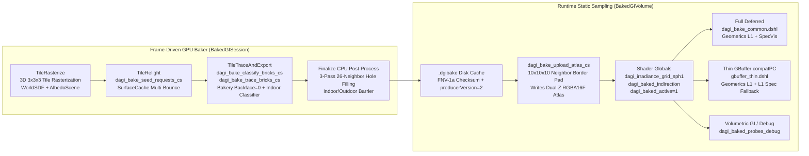

# DagorEngine Static Baked daGI2, Thin GBuffer (compatPC), and ARM64 DX12 Technical Documentation

> 中文版本：[baked_gi_thin_gbuffer_zh.md](./baked_gi_thin_gbuffer_zh.md)

---

## Table of Contents
1. [Overview & System Architecture](#1-overview--system-architecture)
2. [Core Implementation Principles](#2-core-implementation-principles)
   - [2.1 Sparse Brick Grid & `.dgibake` Binary Format](#21-sparse-brick-grid--dgibake-binary-format)
   - [2.2 Dual-Z Single-Texture 3D Atlas & Zero-Register Indirection](#22-dual-z-single-texture-3d-atlas--zero-register-indirection)
   - [2.3 Frame-Driven Non-Blocking Baker & Bakery-Inspired Indoor Occlusion](#23-frame-driven-non-blocking-baker--bakery-inspired-indoor-occlusion)
   - [2.4 Runtime Shading: Geomerics L1 SH, Normal-Only Bias & Specular Occlusion](#24-runtime-shading-geomerics-l1-sh-normal-only-bias--specular-occlusion)
   - [2.5 Thin GBuffer (compatPC) Pipeline & Feature Validation](#25-thin-gbuffer-compatpc-pipeline--feature-validation)
   - [2.6 ARM64 DX12 Shader Model 6.0 Support](#26-arm64-dx12-shader-model-60-support)
   - [2.7 In-Game 3D Debug Visualization & A/B Comparison](#27-in-game-3d-debug-visualization--ab-comparison)
3. [Configuration Reference, Normal/High Tier Switching & Presets](#3-configuration-reference-normalhigh-tier-switching--presets)
4. [Console Commands, ConVars & ImGui Panel](#4-console-commands-convars--imgui-panel)
5. [Build, Shader Compilation & Maintenance Guide](#5-build-shader-compilation--maintenance-guide)

---

## 1. Overview & System Architecture

This implementation introduces and connects three capabilities in DagorEngine, targeting **low-power / bandwidth-constrained GPUs and sub-SM6.5 platforms such as Windows on ARM64 (e.g., Snapdragon 8cx Gen 3)**:

1. **Static Baked daGI2**: Pre-bakes a sparse 3D SH1 irradiance probe volume (`.dgibake`) on the GPU in non-blocking per-frame slices whenever a cache is missing. At runtime, dynamic `WorldSDF`, `SurfaceCache`, `ScreenProbes`, and LRU voxelization are completely shut down (`closeGI()`), leaving only a single 3D atlas texture and one `ByteAddressBuffer`.
2. **PC Thin GBuffer (`compatPC`) Pipeline**: Enables the mobile-style two-MRT forward-lit GBuffer path (`sunLight` + `ambientLight`) on PC via `renderFeatures/fullDeferred:b=no`, backed by dedicated `compatShaders` shader dumps and automatic feature pruning.
3. **ARM64 DX12 Support**: Lowers the default minimum DX12 Shader Model requirement from `SM 6.5` to `SM 6.0` on ARM64 hosts and compiles DX12 shader dumps without requiring hardware raytracing or VRS variants.

### End-to-End Architecture



---

## 2. Core Implementation Principles

### 2.1 Sparse Brick Grid & `.dgibake` Binary Format

Files: [daGIBakeCache.h](../prog/gameLibs/daGI2/bake/daGIBakeCache.h), [daGIBakeCache.cpp](../prog/gameLibs/daGI2/bake/daGIBakeCache.cpp)

- **Grid & Brick Layout**:
  - The bake `worldBox` is snapped to brick multiples of `brickWorld = 8 * probeSize`, forming `gridDim = (gx, gy, gz)`.
  - Each active brick holds `8 × 8 × 8 = 512` probes; open sky and deep underground bricks are skipped by `dagi_bake_classify_bricks_cs`.
- **Probe Encoding (12 Bytes/Probe)**:
  - `sph0` (`uint32_t` / `RGBA8`): `R, G = amb.rg / sum`, `B, A = up.rg / sum` (normalized L0 and upward tint chromaticity).
  - `sph1` (`uint64_t` / `RGBA16F`): `R = amb.sum` (total ambient luminance), `GBA = dir.xyz` (L1 directional dipole).
- **`.dgibake` Binary Structure (Little-Endian)**:
  1. Prefix: `8B` Magic (`"DGIBAKE\0"`) + `4B` `headerSize`.
  2. Header: `formatVersion` (`1`), `producerVersion` (runtime requires `>= 2`), `tier` (`0=Normal`, `1=High`), `levelId`, `contentHash`, `lightingSignature`, `stateCount`, `brickSize` (`8`), `brickCount`, `payloadSize`, `payloadChecksum` (FNV-1a 64-bit).
  3. Payload:
     - `32B` Volume Metadata: `origin[3]` (`float`), `probeSize` (`float`), `gridDim[3]` (`uint32`), `brickCount` (`uint32`).
     - `brickCount × 8B`: `BrickCoord { uint16 x, y, z, flags }`.
     - `brickCount × 512 × 4B`: `sph0[]`.
     - `brickCount × 512 × 8B`: `sph1[]`.
- **Selection Matrix & Option A Fallback**:
  - `SourceMode::Auto` on Full Deferred: loads valid `.dgibake` cache if present; automatically falls back to live dynamic daGI2 if the cache is deleted.
  - `SourceMode::Baked` or Thin GBuffer (where live dynamic GI is unsupported): forces static baked mode and automatically bakes a Normal-tier cache when missing.
  - **Option A**: when configured for `High` (`0.5m`) and only `Normal` (`1.0m`) exists, loads `Normal` immediately so gameplay is unblocked and sets `promptRebuildHigh = true` to notify the user in HUD/ImGui.

---

### 2.2 Dual-Z Single-Texture 3D Atlas & Zero-Register Indirection

Files: [dagi_bake_common.dshl](../prog/gameLibs/daGI2/shaders/dagi_bake_common.dshl), [dagi_bake.dshl](../prog/gameLibs/daGI2/shaders/dagi_bake.dshl), [shader_global.dshl](../prog/daNetGame/shaders/shader_global.dshl), [daGIBakeRuntime.cpp](../prog/gameLibs/daGI2/bake/daGIBakeRuntime.cpp)

#### Why Zero Extra Global Registers
Existing complex shaders (`water_3d`, `land_aces`, `downsample_depth_hzb`) are already at constant-buffer register limits (`c75`/`c78`) and SRV slot limits (`t4`). Adding extra global `@f4` shadervars or a second 3D texture to `global_frame` / `DAGI_BAKED_SAMPLE_CONSTS_INIT` causes DX12/Compat shader compilation failures.

#### Design
1. **Dual-Z Single-Texture 3D Atlas (`dagi_irradiance_grid_sph1`)**:
   - Each `8×8×8` brick is padded to `10×10×10` with a 1-texel border copied from neighbor bricks in `dagi_bake_upload_atlas_cs` for seamless hardware trilinear filtering across brick seams.
   - `atlasSide` is chosen as the smallest cube side with $atlasSide^3 \ge brickCount$ (`atlasTexels = atlasSide × 10`).
   - Reuses the existing `dagi_irradiance_grid_sph1` texture as a `W × W × 2W` `TEXFMT_A16B16G16R16F` volume:
     - **Bottom half $z \in [0, 0.5)$**: stores `s0` (originally `sph0` RGBA8).
     - **Top half $z \in [0.5, 1.0)$**: stores `s1` (RGBA16F).
2. **48-Byte Embedded Header inside `dagi_baked_indirection` (`ByteAddressBuffer`)**:
   - Packs all volume metadata in the first 48 bytes (12 dwords) before the `uint16` sparse brick lookup table (`0xFFFF` = empty):
     - `[0..15]`: `int4(gx, gy, gz, atlasSide)`
     - `[16..31]`: `float4(origin.xyz, 1.0 / probeSize)`
     - `[32..47]`: `float4(1/atlasTexels, 1/atlasTexels, 1/atlasTexels, probeSize)`
     - `[48..]`: packed pairs of `uint16` brick indices.
   - In `compatPC`, `global_frame` binds `gbuffer_dagi_baked_sph1`, `gbuffer_dagi_baked_indirection`, and `gbuffer_dagi_baked_active` cleanly without clipmap cbuffers.

#### Critical GPU Upload & Binding Invariants
In `BakedGIVolume::Impl::uploadVolumeToGpu()` ([daGIBakeRuntime.cpp](../prog/gameLibs/daGI2/bake/daGIBakeRuntime.cpp)):
1. Call `bindStandInTexturesWhenDaGIOff()` **before** binding the real `indirectionBuf` and `atlasSph1` — otherwise `initFallback()` (while `loaded == false`) overwrites `dagi_baked_indirection` back to the all-zero `fallbackIndirection`, causing every shader to see `gridDim.w == 0` and fall back to unoccluded sky SH.
2. Bind `atlasSph1` to `dagi_irradiance_grid_sph1VarId` before dispatching `dagi_bake_upload_atlas_cs` — the compute shader writes its UAV output directly to `dagi_irradiance_grid_sph1@uav`. Binding `fallbackSph1` instead would discard all atlas writes into a `2×2×2` dummy texture. To prevent DX11 SRV/UAV simultaneous-bind hazards on `global_frame`, temporarily clear `ShaderGlobal::LAYER_FRAME` (`setBlock(-1, LAYER_FRAME)`) around the compute dispatch and restore it after the `RB_RO_SRV` barrier.
3. Re-bind `indirectionBuf` and `dagi_baked_active` inside `ensureFallbackBound()` when `loaded == true`.

---

### 2.3 Frame-Driven Non-Blocking Baker & Bakery-Inspired Indoor Occlusion

Files: [daGIBakeRuntime.cpp](../prog/gameLibs/daGI2/bake/daGIBakeRuntime.cpp), [dagi_bake.dshl](../prog/gameLibs/daGI2/shaders/dagi_bake.dshl), [worldRendererGIES.cpp.inl](../prog/daNetGame/render/world/worldRendererGIES.cpp.inl)

#### Non-Blocking Per-Frame State Machine & 3D Tiling
To stay well within Windows WDDM's 2-second TDR timeout, `BakedGISession::tick()` executes bounded work per frame across 4 stages:
1. `TileRasterize`: rasterizes `sdfClips` cascades of `WorldSDF` (`texWidth=128`, `yResScale=1.0`) and `AlbedoScene` (3 clips) centered on the current 3D `(tx, ty, tz)` tile. [worldRendererGIES.cpp.inl](../prog/daNetGame/render/world/worldRendererGIES.cpp.inl) saves and restores `world_view_pos` around `tick()` so FrameGraph `/debug/*` nodes never report spurious variable mutation errors.
2. `TileRelight`: dispatches `dagi_bake_seed_requests_cs` across WorldSDF narrow-band surface voxels to seed a temporary 1M-entry `SurfaceCache`, then runs `dagi.beforeFrameLit(0.f)` in batches of up to 16 steps per frame for multi-bounce indirect lighting.
3. `TileTraceAndExport`: classifies active bricks (`dagi_bake_classify_bricks_cs`) and dispatches `dagi_bake_trace_bricks_cs` in batches of $\le 64$ bricks (one 64-thread group per probe using randomized Fibonacci sphere directions).
4. `Finalize`: releases temporary dynamic GI structures, runs 3-pass CPU hole-filling dilation, writes `.dgibake` (`producerVersion = 2`), uploads the Dual-Z GPU atlas, and switches the renderer to static GI.

| Tier | Cache File Name | `probeSize` | Tile Extent (`3×3×3` bricks) | `sdfVoxel0` | `sdfClips` | Rays / Probe | Bounce Rounds | Max Ray Dist |
| --- | --- | --- | --- | --- | --- | --- | --- | --- |
| `Normal` | `<level>_gi_normal.dgibake` | `1.00 m` | `24 × 24 × 24 m` | `0.16 m` | `5` | `64` | `2` | `64 m` |
| `High` | `<level>_gi_high.dgibake` | `0.50 m` | `12 × 12 × 12 m` | `0.10 m` | `6` | `128` | `3` | `96 m` |

> Using **3D `(tx, ty, tz)` tiling with `yResScale = 1.0`** ensures an entire `3×3×3` tile stays inside fine WorldSDF Clip 0/1 at ground-floor room elevations.

#### Five Anti-Leak Techniques Adapted from Bakery GPU Lightmapper
1. **Deep-Solid Cull & Bounded Step-Out with Slab-Crossing Guard**:
   - Probes starting deep inside solid geometry (`initDist < -min(0.65 * probeSize, 0.5)`) are flagged invalid (`state = 0`) without tracing.
   - Only probes within `min(0.15 * probeSize, 0.12)` of a surface run bounded step-out (`maxPush = min(0.3 * probeSize, 0.2)`) and are rejected as invalid if the displacement midpoint crosses another solid slab (`< -0.05`).
2. **Bakery `Backface GI = 0`**:
   - Rays hitting the interior/back side of SDF geometry (`dot(hitNormal, rayDir) > 0.15`) contribute `0` radiance instead of flipping the normal to sample the sunlit exterior wall. Probes with $> 75\%$ backface hits are marked invalid (`state = 0`).
   - Removed the unoccluded `0.08 * GetSkySHDiffuseSimple` fallback on `SurfaceCache` misses.
3. **Automatic Enclosed-Room Classifier + `envi_probe_box` OBB Tagging**:
   - On GPU, upper-hemisphere rays (`rayDir.y > 0.1`) with $< 30\%$ sky hits classify the probe as **indoor** (`state = 2`), vs **outdoor** (`state = 1`).
   - On CPU ([worldRendererGIES.cpp.inl](../prog/daNetGame/render/world/worldRendererGIES.cpp.inl)), `envi_probe_box` OBB inverse transforms (`indoorInvTms`) from `getEnviProbeBoxesScene()` also upgrade enclosed probes to `state = 2`.
4. **3-Pass 26-Neighbor Hole-Filling Dilation with Indoor Isolation Barrier**:
   - During `Finalize`, invalid probes (`state == 0`) are dilated from valid neighbors over 3 passes:
     - `state == 2` (indoor) never blends with `state == 1` (outdoor).
     - Any invalid wall-embedded probe adjacent to at least one indoor probe exclusively prefers `state == 2` neighbors, preventing trilinear filtering near walls from pulling exterior sky light indoors.

---

### 2.4 Runtime Shading: Geomerics L1 SH, Normal-Only Bias & Specular Occlusion

Files: [dagi_bake_common.dshl](../prog/gameLibs/daGI2/shaders/dagi_bake_common.dshl), [gbuffer_thin.dshl](../prog/daNetGame/shaders/gbuffer_thin.dshl), [deferred_light_common.dshl](../prog/daNetGame/shaders/deferred_light_common.dshl)

1. **Unclamped Decode + Geomerics Non-Linear L1 SH Reconstruction**:
   - Dynamic daGI2 defines `DAGI_IRRADIANCE_SH1_MIN_THRESHOLD_AMBIENT_MUL 0.5` in [deferred_light_common.dshl](../prog/daNetGame/shaders/deferred_light_common.dshl), lifting dark areas to half of `amb`. Baked sampling uses `dagi_irrad_decode_sh1_unclamped` to preserve full indoor contrast.
   - Matching Dagor's `sh1_premul` packing (`half4(1, dir.yzx)`, where `r1 = 0.5 * c.wyz`), directional diffuse uses the energy-conserving, ringing-free **Geomerics L1 SH** formula:
     - $q = 0.5 (1 + \hat{r}_1 \cdot \mathbf{N})$, $t = \min(|r_1| / r_0, 0.995)$, $p = 1 + 2t$, $a = (1 - t)/(1 + t)$
     - $E(\mathbf{N}) = r_0 \left[ a + (1 - a)(p + 1)\max(q, 10^{-4})^p \right]$
2. **Bounded Normal-Only Bias**:
   - Removes view-ray offset (`ofs = 0.0` in [deferred_light_common.dshl](../prog/daNetGame/shaders/deferred_light_common.dshl)) and biases only along surface normal by `min(0.45 * probeSize, 0.45)`. This eliminates light leaking across thin roofs/walls caused by pulling samples up to `3m` toward the camera.
3. **Indoor Specular Occlusion**:
   - **Full Deferred** ([deferred_light_common.dshl](../prog/daNetGame/shaders/deferred_light_common.dshl)): When `HAS_SPECULAR == false` and baked GI is active, computes `specVis` from local undirectional baked SH0 vs `GetSkySHDiffuseSimple(float3(0,1,0))`, attenuating leaked outdoor `enviProbe` while preserving `indoorRefl__localWeight.xyz`.
   - **Thin GBuffer** ([gbuffer_thin.dshl](../prog/daNetGame/shaders/gbuffer_thin.dshl)): Attenuates `gbuffer_envi_probe_specular` by `bakedSpecVis` and blends in an L1 dominant-direction SH1 specular fallback indoors.

---

### 2.5 Thin GBuffer (compatPC) Pipeline & Feature Validation

Files: [initRes.cpp](../prog/daNetGame/main/client/initRes.cpp), [worldRenderer.cpp](../prog/daNetGame/render/world/worldRenderer.cpp), [shaders_compat11.blk](../samples/dngSceneViewer/prog/shaders/shaders_compat11.blk), [shaders_compat12.blk](../samples/dngSceneViewer/prog/shaders/shaders_compat12.blk)

1. **Shader Dump Routing** (`init_shaders()` in [initRes.cpp](../prog/daNetGame/main/client/initRes.cpp)):
   - Automatically selects `compatShaders` (`"compiledShaders/compatPC/game"`) when `graphics/preset == "bareMinimum"` **or** `renderFeatures/fullDeferred == false`, preventing black screens from missing `thin_g_resolve`.
2. **Startup Feature Validation** (`WorldRenderer::ctorCommon()` & `validateFeatures()` in [worldRenderer.cpp](../prog/daNetGame/render/world/worldRenderer.cpp)):
   - Calls `validateFeatures(featureRenderFlags, FeatureRenderFlagMask().set())` immediately at initialization.
   - Disables 17 incompatible features when `!FULL_DEFERRED`: `SSR`, `DEFERRED_LIGHT`, `COMBINED_SHADOWS`, `TAA`, `DOWNSAMPLED_NORMALS`, `GBUFFER_PACKED_NORMALS`, `CONTACT_SHADOWS`, `SPECULAR_CUBES`, `WATER_PERLIN`, `WATER_REFLECTION`, `RIPPLES`, `BLOOM` (also cleanly disabling `DOF`), `MICRODETAILS`, `FOM_SHADOWS`, `DOWNSAMPLED_SHADOWS`, `UPSCALE_SAMPLING_TEX`, and `VOLUME_LIGHTS_PER_PIXEL_FX_APPLY`.

---

### 2.6 ARM64 DX12 Shader Model 6.0 Support

Files: [device.cpp](../prog/engine/drv/drv3d_DX12/device.cpp), [shaders_dx12.blk](../samples/dngSceneViewer/prog/shaders/shaders_dx12.blk), [copy_bundles.jam](../prog/engine/drv/drv3d_DX12/copy_bundles.jam)

- On `#if defined(_M_ARM64) || defined(__aarch64__)`, `check_device_features()` lowers the default `dx12/minShaderModel` from `D3D_SHADER_MODEL_6_5` to `D3D_SHADER_MODEL_6_0` (still overridable via config).
- [shaders_dx12.blk](../samples/dngSceneViewer/prog/shaders/shaders_dx12.blk) pins `hardware_raytracing:i=0`, `rtsm_enabled:i=0`, and `vrs_enabled:i=0` so SM 6.0/6.2 ARM64 GPUs such as Snapdragon 8cx Gen 3 run DX12 cleanly.

---

### 2.7 In-Game 3D Debug Visualization & A/B Comparison

Files: [debugNodesES.cpp.inl](../prog/daNetGame/render/world/frameGraphNodes/debugNodesES.cpp.inl), [dagi_bake.dshl](../prog/gameLibs/daGI2/shaders/dagi_bake.dshl), [daGIBakeRuntime.cpp](../prog/gameLibs/daGI2/bake/daGIBakeRuntime.cpp), [worldRendererGIES.cpp.inl](../prog/daNetGame/render/world/worldRendererGIES.cpp.inl)

- **FrameGraph `/debug/gi_node` Bindings**: Explicitly binds `viewTm`, `jitterProjTm`, and `world_view_pos` on `"gi_node"` so `globtm` is valid during debug rendering.
- **3D SH1 Probe Spheres (`dagi_baked_probes_debug`)**: Replaces `testSphereB()` (whose `frustumPlanes` were unpopulated when dynamic `daGI2 == nullptr`) with `clipPos.w <= 0.001` culling and shades spheres with the exact same Geomerics L1 SH evaluator used in scene passes.
- **X-Ray + Depth-Tested Brick Wireframes (`BakedGIVolume::drawDebugBricks`)**: Draws a faint non-depth-tested X-ray pass first so room bricks stay visible through walls, followed by a crisp depth-tested wireframe pass.
- **HUD, ImGui & A/B Toggle**: Shows live pipeline, API, brick occupancy, camera brick index, and bake progress bar; `gi.baked_ab` flips `dagi_baked_active` in real time.

---

## 3. Configuration Reference, Normal/High Tier Switching & Presets

Settings file: [dng_scene_viewer.config.blk](../samples/dngSceneViewer/viewer/dng_scene_viewer.config.blk).

| Config Path | Type | Values / Default | Description |
| --- | --- | --- | --- |
| `shadersPath` (root) | `t` | `"compiledShaders/game"` | Shader dump prefix for Full Deferred |
| `compatShaders` (root) | `t` | `"compiledShaders/compatPC/game"` | Shader dump prefix for Thin GBuffer / `bareMinimum` |
| `video/driver` | `t` | `"auto"` / `"dx11"` / `"dx12"` | Graphics backend (both `dx11` and `dx12` work on ARM64) |
| `dx12/minShaderModel` | `i` | ARM64 `96` (`0x60` SM6.0) / x64 `101` (`0x65` SM6.5) | Minimum HLSL SM check override for DX12 |
| `renderFeatures/fullDeferred` | `b` | `yes` / `no` (default `yes`) | **`yes` = Full Deferred; `no` = Thin GBuffer (`compatPC`)** |
| `graphics/preset` | `t` | `"medium"` / `"bareMinimum"` | Setting `"bareMinimum"` also switches to `compatPC` |
| `graphics/gi` / `graphics/giAlgorithm` | `t` | `"high"` / `"medium"` / `"low"` / `"off"` | GI quality tier (`"off"` disables both dynamic and baked GI) |
| `graphics/giSource` (or `graphics/gi/source`) | `t` | `"auto"` / `"baked"` / `"dynamic"` | **`auto`**: load `.dgibake` if valid, else dynamic on Full / bake on Thin; **`baked`**: force baked; **`dynamic`**: force dynamic (Full only) |
| `graphics/giBakeTier` (or `graphics/gi/bakeTier`) | `t` | `"normal"` / `"high"` | `normal` (`1.0m`, 64 rays, 2 bounces) or `high` (`0.5m`, 128 rays, 3 bounces) |
| `graphics/giForceRebuild` | `b` | `no` / `yes` | Force rebake on level load |
| `graphics/giBakeDir` | `t` | `"baked_gi"` | Output directory for `.dgibake` files |
| `graphics/giDebugOverlay` | `b` | `no` / `yes` | Auto-show on-screen HUD overlay at startup |
| `graphics/gi/bakeHalfExtentXZ` | `r` | `120.0` (`32..2048`) | Auto-computed bake box XZ half-extent (meters) |
| `graphics/gi/bakeHalfExtentY` | `r` | `16.0` (`8..256`) | Auto-computed bake box Y half-extent reference (meters) |
| `graphics/gi/bakeProbeSizeNormal` / `bakeProbeSizeHigh` | `r` | `0.0` (use defaults) | Override probe spacing when `> 0` (`1.0m` / `0.5m` default) |

### Switching Between `normal` and `high` Static Baked Datasets

The `normal` (`<level>_gi_normal.dgibake`, `1.00m` probe spacing) and `high` (`<level>_gi_high.dgibake`, `0.50m` probe spacing) caches are **stored as separate files under `giBakeDir` (`baked_gi/`) and never overwrite each other**. When both caches are present on disk, you can switch between them in any of three ways:

1. **Config File Startup Selection** ([dng_scene_viewer.config.blk](../samples/dngSceneViewer/viewer/dng_scene_viewer.config.blk)):
   ```blk
   graphics{
     giSource:t="baked"      // or "auto"
     giBakeTier:t="normal"   // change to "high" to load <level>_gi_high.dgibake at startup
   }
   ```
   - **Both files present**: immediately loads the tier specified by `giBakeTier` (`normal` or `high`) with zero baking wait.
   - **Option A Fallback (`giBakeTier="high"`, `_gi_high.dgibake` missing)**: immediately loads `_gi_normal.dgibake` so gameplay stays unblocked, and displays `Notice: High tier missing; loaded Normal tier (run 'gi.bake high')` in the HUD (`gi.debug_hud 1`) and ImGui panel. If `_gi_normal.dgibake` is also missing (in `baked` or Thin GBuffer mode), a Normal-tier bake starts automatically.
   - **Force Rebuild at Startup**: temporarily set `giForceRebuild:b=yes` to bypass existing caches on load and force-bake the configured tier (remember to reset to `no` afterward).

2. **In-Game Console Commands (Live Bake / Switch)**:
   - `gi.bake normal` — bakes (or re-bakes) `_gi_normal.dgibake` (`1.00m` / 64 rays) and switches to it immediately on completion.
   - `gi.bake high` — bakes `_gi_high.dgibake` (`0.50m` / 128 rays) and switches to it immediately on completion (leaving `_gi_normal.dgibake` intact on disk).
   - `gi.bake_delete normal` / `gi.bake_delete high` — removes one tier cache individually.

3. **ImGui Panel (`Render -> daGI2 Baked GI`)**:
   - Displays `[VALID] / [MISSING]` status badges for both `Normal` and `High` cache paths and provides one-click **`Bake Normal (64 rays)`**, **`Bake High (128 rays)`**, and per-tier delete buttons.

4. **Verify Active Tier**:
   - Run `gi.bake_status` in the console or open the HUD (`gi.debug_hud 1`) and check `Mode: BAKED STATIC (normal|high)` and `Probe: 1.00m | 0.50m`.

### Ready-to-Use Presets

- **Full Deferred + Dynamic daGI2**:
  ```blk
  video{ driver:t="dx11" }
  renderFeatures{ fullDeferred:b=yes }
  graphics{ giSource:t="dynamic" }
  ```
- **Full Deferred + Baked Static GI**:
  ```blk
  video{ driver:t="dx12" }
  renderFeatures{ fullDeferred:b=yes }
  graphics{
    giSource:t="baked"
    giBakeTier:t="high"     // falls back to normal via Option A if high cache is absent
    giDebugOverlay:b=yes
  }
  ```
- **Thin GBuffer (`compatPC`) + Baked Static GI**:
  ```blk
  video{ driver:t="dx11" }  // or "dx12" on ARM64
  renderFeatures{ fullDeferred:b=no }
  graphics{
    giSource:t="baked"
    giBakeTier:t="normal"
    giDebugOverlay:b=yes
  }
  ```

---

## 4. Console Commands, ConVars & ImGui Panel

### Console Commands (`gi_bake_console_handler`)

| Command | Arguments | Behavior |
| --- | --- | --- |
| `gi.bake [normal\|high]` | Optional tier (defaults to configured `giBakeTier`) | Forces an immediate non-blocking rebake and activates the new cache upon completion |
| `gi.bake_status` | None | Prints active pipeline, tier, loaded bricks, probe size, bake progress, and cache validity paths |
| `gi.bake_delete [normal\|high\|all]` | Default `all` | Deletes cached `.dgibake` file(s) and refreshes GI mode (falls back to dynamic on Full/`auto`, or triggers rebake on Thin/`baked`) |
| `gi.debug_hud [0\|1]` | Optional bool (toggles if omitted) | Shows/hides the top-left baked GI status & bake progress HUD |
| `gi.debug_vis [0..3] [radius]` | `0`=Off, `1`=SH1 Probe Spheres, `2`=Brick Wireframes (X-ray+Depth), `3`=Both; `radius` `4..192m` | Cycles or sets 3D in-world visualization mode and view radius |
| `gi.baked_ab [0\|1]` | `1`=On, `0`=Sky SH fallback, toggles if omitted | Instant zero-cost A/B comparison flipping `dagi_baked_active` |

### ConVars

| ConVar | Type / Range | Default | Description |
| --- | --- | --- | --- |
| `render.gi_baked_debug_hud` | `bool` | `false` | Controls on-screen HUD overlay |
| `render.gi_baked_debug_vis` | `int [0..3]` | `0` | 3D visualization mode (`0`=Off, `1`=Probes, `2`=Bricks, `3`=Both) |
| `render.gi_baked_debug_radius` | `float [4..192]` | `32.0` | Visualization radius around camera (meters) |
| `render.gi_baked_debug_sphere_scale` | `float [0.02..0.40]` | `0.08` | Debug probe sphere radius multiplier relative to `probeSize` |
| `render.gi_enabled` | `bool` | `true` | Master GI enable toggle |
| `render.gi_quality` | `int [0..2]` | `1` | `0=only_ao` (locked on Thin GBuffer), `1=colored` (baked Full Deferred), `2=screen_probes` |

### ImGui Window
Open ImGui → `Render` → `daGI2 Baked GI` for one-click access to HUD toggle, A/B comparison checkbox, `gi.debug_vis` combo/sliders, cache validity badges, and **`Bake Normal (64 rays)`** / **`Bake High (128 rays)`** / **`Cancel Bake`** / delete controls.

---

## 5. Build, Shader Compilation & Maintenance Guide

### 5.1 Build & Shader Commands

1. **Build `dng_scene_viewer-dev.exe` (Windows ARM64)** from `samples/dngSceneViewer/prog` inside the repository root:
   ```powershell
   & "..\..\..\devtools\jam.exe" -j8 -sPlatformSpec=vc17 -sPlatformArch=arm64
   ```
   Unit tests for cache serialization & selection live in [test_daGIBakeCache.cpp](../prog/gameLibs/daGI2/bake/tests/test_daGIBakeCache.cpp).

2. **Compile DX11 & DX12 Shader Dumps (Full Deferred + CompatPC)** from `samples/dngSceneViewer/prog/shaders`:
   ```cmd
   compile_shaders_dx11_WOA.bat
   compile_shaders_dx12_WOA.bat
   ```
   Produces 4 `.shdump.bin` files under `samples/dngSceneViewer/viewer/compiledShaders/`:
   - `game.ps50.shdump.bin` (DX11 Full) & `compatPC/game.ps50.shdump.bin` (DX11 Thin)
   - `gameDX12.ps50.shdump.bin` (DX12 Full) & `compatPC/gameDX12.ps50.shdump.bin` (DX12 Thin)

### 5.2 Key Source Map & Critical Invariants

| Component | Files | Key Responsibility |
| --- | --- | --- |
| Public API | [daGIBake.h](../prog/gameLibs/publicInclude/daGI2/daGIBake.h) | `BakedGIVolume`, `BakeParams`, `BakedGISession` |
| Cache I/O & Policy | [daGIBakeCache.h](../prog/gameLibs/daGI2/bake/daGIBakeCache.h), [daGIBakeCache.cpp](../prog/gameLibs/daGI2/bake/daGIBakeCache.cpp) | `.dgibake` binary R/W, FNV-1a checksum, Option A tier/source selection |
| GPU Baker & Runtime | [daGIBakeRuntime.cpp](../prog/gameLibs/daGI2/bake/daGIBakeRuntime.cpp) | Dual-Z atlas upload, 4-stage baker, 3-pass dilation, 3D debug draw |
| Bake & Debug CS/VS/PS | [dagi_bake.dshl](../prog/gameLibs/daGI2/shaders/dagi_bake.dshl) | Seeding, brick classify, trace + backface=0 + room flag, 10³ upload, probe debug |
| Shared Sampling | [dagi_bake_common.dshl](../prog/gameLibs/daGI2/shaders/dagi_bake_common.dshl) | 48B header unpack, Dual-Z sampling, unclamped SH1, Geomerics L1, normal bias |
| Deferred & Volumetric | [dagi_irrad_grid_sample.dshl](../prog/gameLibs/daGI2/shaders/radianceGrid/dagi_irrad_grid_sample.dshl), [volumetric_radiance_trace.dshl](../prog/gameLibs/daGI2/shaders/volumetricGI/volumetric_radiance_trace.dshl), [deferred_light_common.dshl](../prog/daNetGame/shaders/deferred_light_common.dshl) | Runtime GI branch, camera-offset removal (`ofs=0`), indoor sky spec attenuation |
| Thin GBuffer | [gbuffer_thin.dshl](../prog/daNetGame/shaders/gbuffer_thin.dshl), [gbuffer_forward.dshl](../prog/daNetGame/shaders/gbuffer_forward.dshl), [shader_global.dshl](../prog/daNetGame/shaders/shader_global.dshl) | Direct `compatPC` SH1 sampling, Geomerics L1 & SH1 specular fallback |
| WorldRenderer Integration | [worldRendererGIES.cpp.inl](../prog/daNetGame/render/world/worldRendererGIES.cpp.inl), [worldRenderer.cpp](../prog/daNetGame/render/world/worldRenderer.cpp), [debugNodesES.cpp.inl](../prog/daNetGame/render/world/frameGraphNodes/debugNodesES.cpp.inl) | Mode dispatch, OBB box gather, `world_view_pos` guard, Thin feature pruning, `gi_node` camera binds |
| Startup & DX12 | [initRes.cpp](../prog/daNetGame/main/client/initRes.cpp), [device.cpp](../prog/engine/drv/drv3d_DX12/device.cpp) | `compatPC` dump routing, ARM64 `SM 6.0` minimum requirement |

#### Maintenance Pitfalls to Avoid
1. **Do NOT add new global registers or samplers to `global_frame` / `DAGI_BAKED_SAMPLE_CONSTS_INIT`**: register/SRV slots are saturated in DX12 and CompatPC; pack metadata into `dagi_baked_indirection` instead.
2. **Bump `CURRENT_BAKE_PRODUCER_VERSION` whenever bake encoding or layout changes** (`2u` in [daGIBakeRuntime.cpp](../prog/gameLibs/daGI2/bake/daGIBakeRuntime.cpp)) so stale `.dgibake` caches are automatically rejected and rebuilt.
3. **Preserve `uploadVolumeToGpu()` binding order**: call `bindStandInTexturesWhenDaGIOff()` *before* setting `indirectionBuf` / `atlasSph1`, keep `atlasSph1` bound for UAV upload with `LAYER_FRAME` cleared, and restore globals in `ensureFallbackBound()`.
4. **Keep `dagi_irrad_decode_sh1_unclamped` separate from `dagi_irrad_decode_sh1`**: [deferred_light_common.dshl](../prog/daNetGame/shaders/deferred_light_common.dshl) defines `DAGI_IRRADIANCE_SH1_MIN_THRESHOLD_AMBIENT_MUL 0.5`, which would crush indoor contrast if shared.
