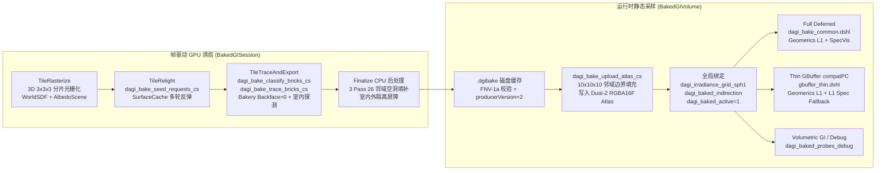

# DagorEngine 静态烘焙全局光照（Static Baked daGI2）、Thin GBuffer（compatPC）与 ARM64 DX12 支持技术文档

> English Version: [baked_gi_thin_gbuffer_en.md](./baked_gi_thin_gbuffer_en.md)

---

## 目录
1. [概述与总体架构](#1-概述与总体架构)
2. [核心实现原理](#2-核心实现原理)
   - [2.1 稀疏砖块网格与 `.dgibake` 二进制格式](#21-稀疏砖块网格与-dgibake-二进制格式)
   - [2.2 双 Z（Dual-Z）单纹理 3D 图集与零常量寄存器寻址](#22-双-zdual-z单纹理-3d-图集与零常量寄存器寻址)
   - [2.3 帧驱动非阻塞烘焙管线与 Bakery 风格室内遮蔽方案](#23-帧驱动非阻塞烘焙管线与-bakery-风格室内遮蔽方案)
   - [2.4 运行时着色：Geomerics L1 SH、纯法线偏移与高光遮蔽](#24-运行时着色geomerics-l1-sh纯法线偏移与高光遮蔽)
   - [2.5 Thin GBuffer（compatPC）管线适配与 Feature 自动裁剪](#25-thin-gbuffercompatpc管线适配与-feature-自动裁剪)
   - [2.6 ARM64 DX12 Shader Model 6.0 支持](#26-arm64-dx12-shader-model-60-支持)
   - [2.7 游戏内实时调试视图与 A/B 对比](#27-游戏内实时调试视图与-ab-对比)
3. [配置文件详解、Normal/High 档位切换与预设](#3-配置文件详解normalhigh-档位切换与预设)
4. [控制台指令、ConVar 与 ImGui 面板](#4-控制台指令convar-与-imgui-面板)
5. [编译构建与维护指南](#5-编译构建与维护指南)

---

## 1. 概述与总体架构

本方案针对 **Windows ARM64（如 Snapdragon 8cx Gen 3）等低功耗 GPU / 无 SM 6.5+ 硬件平台**，在 DagorEngine 中新增并打通了三大能力：

1. **静态烘焙 daGI2（Static Baked daGI2）**：在加载关卡且缺失缓存时通过帧驱动非阻塞 GPU 烘焙生成稀疏 3D SH1 探针体缓存（`.dgibake`）；游戏运行时完全关闭实时 `WorldSDF`、`SurfaceCache`、`ScreenProbes` 等动态 GI 计算，仅通过单张 3D Atlas + 1 个 `ByteAddressBuffer` 完成常量级查表采样。
2. **PC 端 Thin GBuffer（`compatPC`）移动端风格渲染管线**：通过 `renderFeatures/fullDeferred:b=no` 启用双 MRT（`sunLight` + `ambientLight`）前向/精简 GBuffer 管线，配合 `compatShaders` 独立着色器转储与特征自动屏蔽机制，大幅降低内存带宽消耗。
3. **ARM64 DX12 兼容支持**：在 DX12 驱动设备特性检查中针对 ARM64 架构将默认最低 Shader Model 放宽至 `SM 6.0`（`0x60`），并在 DX12 着色器构建配置中屏蔽对 RT/VRS 等高级硬件特性的依赖。

### 总体数据流架构



---

## 2. 核心实现原理

### 2.1 稀疏砖块网格与 `.dgibake` 二进制格式

实现文件：[daGIBakeCache.h](../prog/gameLibs/daGI2/bake/daGIBakeCache.h)、[daGIBakeCache.cpp](../prog/gameLibs/daGI2/bake/daGIBakeCache.cpp)

- **网格与砖块结构**：
  - 世界包围盒（`worldBox`）对齐至 `brickWorld = 8 * probeSize`，划分为 `gridDim = (gx, gy, gz)` 个稀疏砖块。
  - 每个有效砖块（Brick）固定包含 `8 × 8 × 8 = 512` 个探针（Probe）。
  - 仅保留近地面或近表面（`dagi_bake_classify_bricks_cs`）的活跃砖块，跳过高空空气与深地实体区域。
- **探针编码格式（12 Bytes/Probe）**：
  - `sph0`（`uint32_t` / `RGBA8`）：`R, G = amb.rg / sum`，`B, A = up.rg / sum`（归一化 L0 与朝上色调色度）。
  - `sph1`（`uint64_t` / `RGBA16F`）：`R = amb.sum`（总和亮度标量），`GBA = dir.xyz`（L1 方向偶极子）。
- **`.dgibake` 文件布局（Little-Endian）**：
  1. Prefix：`8B` Magic (`"DGIBAKE\0"`) + `4B` `headerSize`。
  2. Header：`formatVersion`（`1`）、`producerVersion`（当前运行时要求 `>= 2`）、`tier`（`0=Normal`, `1=High`）、`levelId`、`contentHash`、`lightingSignature`、`stateCount`、`brickSize`（`8`）、`brickCount`、`payloadSize`、`payloadChecksum`（FNV-1a 64-bit）。
  3. Payload：
     - `32B` 体元数据：`origin[3]`（`float`）、`probeSize`（`float`）、`gridDim[3]`（`uint32`）、`brickCount`（`uint32`）。
     - `brickCount × 8B`：`BrickCoord { uint16 x, y, z, flags }`。
     - `brickCount × 512 × 4B`：`sph0[]`。
     - `brickCount × 512 × 8B`：`sph1[]`。
- **分级策略与 Selection（Option A）**：
  - `SourceMode::Auto` + Full Deferred：有缓存优先加载，缓存被删或失效时自动回退动态 daGI2。
  - `SourceMode::Baked` 或 Thin GBuffer（`compatPC` 无法运行动态全套 GI）：强制使用静态烘焙；若缺失对应 `.dgibake`，立即启动帧驱动重建 Normal 档位。
  - **Option A 降级策略**：配置目标为 `High`（`0.5m` 间距）但仅存在 `Normal`（`1.0m` 间距）时，先加载 `Normal` 缓存保证可玩，同时设置 `promptRebuildHigh = true` 在 HUD/ImGui 提示用户可按需执行 `gi.bake high`。

---

### 2.2 双 Z（Dual-Z）单纹理 3D 图集与零常量寄存器寻址

实现文件：[dagi_bake_common.dshl](../prog/gameLibs/daGI2/shaders/dagi_bake_common.dshl)、[dagi_bake.dshl](../prog/gameLibs/daGI2/shaders/dagi_bake.dshl)、[shader_global.dshl](../prog/daNetGame/shaders/shader_global.dshl)、[daGIBakeRuntime.cpp](../prog/gameLibs/daGI2/bake/daGIBakeRuntime.cpp)

#### 设计约束：Shader 常量寄存器与 SRV 槽位饱和
DagorEngine 的 `global_frame` 与多个重量级着色器（如 `water_3d`、`land_aces`、`downsample_depth_hzb`）已接近 DX12 / CompatPC 常量寄存器（`c75`/`c78`）与 SRV 槽位（`t4`）上限，无法再往 `global_frame` 添加多个 `@f4` 常量或新的纹理槽。

#### 解决方案
1. **单纹理 Dual-Z 3D 图集（`dagi_irradiance_grid_sph1`）**：
   - 将每个 `8×8×8` 砖块扩边至 `10×10×10`（四周各填 1 texel 邻域砖块边框，确保 GPU 硬件三线性过滤跨越砖块边界时连续无接缝）。
   - 计算最小立方体边长 `atlasSide` 使 $atlasSide^3 \ge brickCount$，`atlasTexels = atlasSide × 10`。
   - 直接复用原本的 `dagi_irradiance_grid_sph1`，创建为 `atlasTexels × atlasTexels × (atlasTexels × 2)` 的 `TEXFMT_A16B16G16R16F`：
     - **下半部 $z \in [0, 0.5)$**：存放 `s0`（原本在 `sph0` 中的 4 个 `0..1` 色度分量，存于 `16F` 精度无损）。
     - **上半部 $z \in [0.5, 1.0)$**：存放 `s1`（`ambSum` + `dir`）。
   - Pixel Shader 仅需一次地址计算和两次 `tex3Dlod` 采样同一个 3D 纹理即可重建完整 SH1。
2. **48 字节内嵌头 `ByteAddressBuffer`（`dagi_baked_indirection`）**：
   - 将原需 3 个 `@i4/@f4` 全局常量的体参数全部打进 `dagi_baked_indirection` 的前 `48` 字节（12 个 `uint32`）：
     - `[0..15]`：`int4(gx, gy, gz, atlasSide)`
     - `[16..31]`：`float4(origin.x, origin.y, origin.z, 1.0 / probeSize)`
     - `[32..47]`：`float4(1/atlasTexels, 1/atlasTexels, 1/atlasTexels, probeSize)`
     - `[48..]`：按线性砖块坐标排列的 `uint16` 稀疏索引表（2 个索引打入 1 个 `uint32`，`0xFFFF` 表示空砖块）。
   - `compatShaders` 管线在 `global_frame` 中额外通过 `gbuffer_dagi_baked_sph1`（纹理）、`gbuffer_dagi_baked_indirection`（缓冲区）、`gbuffer_dagi_baked_active`（开关）复用已有静态全局槽，不占用动态 GI clipmap 寄存器。

#### 关键 GPU 上传与绑定不变量（极其重要）
在 `BakedGIVolume::Impl::uploadVolumeToGpu()`（[daGIBakeRuntime.cpp](../prog/gameLibs/daGI2/bake/daGIBakeRuntime.cpp)）中必须严格遵守以下顺序，否则会导致采样失效或全黑：
1. **先调用 `bindStandInTexturesWhenDaGIOff()`，再绑定真实 `indirectionBuf` 与 `atlasSph1`**：因为 `initFallback()` 在 `loaded == false` 时会把 `dagi_baked_indirection` 置为全 0 的 `fallbackIndirection`。若顺序颠倒，所有着色器都会读到 `gridDim.w == 0` 而回退到天空光。
2. **Dispatch `dagi_bake_upload_atlas_cs` 时必须把真实的 `atlasSph1` 绑定在 `dagi_irradiance_grid_sph1VarId`**：该 Compute Shader 通过 `DAGI_IRRADIANCE_GRID_UAV(cs)` 直接向 `dagi_irradiance_grid_sph1@uav` 写入图集数据；若错绑为 `2×2×2` 的 `fallbackSph1`，所有体素会越界丢弃，导致 `atlasSph1` 保持全 0。为规避 DX11 下 `global_frame` 潜在的 SRV/UAV 同时绑定冲突，调度前后临时执行 `ShaderGlobal::setBlock(-1, ShaderGlobal::LAYER_FRAME)` 并在 `RB_RO_SRV` 屏障后恢复。
3. **`ensureFallbackBound()` 在 `loaded == true` 时同步刷新 `indirectionBuf` 和 `dagi_baked_active`**：防止后续状态切换或重置时被哑缓冲覆盖。

---

### 2.3 帧驱动非阻塞烘焙管线与 Bakery 风格室内遮蔽方案

实现文件：[daGIBakeRuntime.cpp](../prog/gameLibs/daGI2/bake/daGIBakeRuntime.cpp)、[dagi_bake.dshl](../prog/gameLibs/daGI2/shaders/dagi_bake.dshl)、[worldRendererGIES.cpp.inl](../prog/daNetGame/render/world/worldRendererGIES.cpp.inl)

#### 非阻塞状态机与 3D 分片参数
为了避免一次性离线烘焙耗时超过 Windows WDDM 2 秒 TDR 限制，`BakedGISession` 在每帧 `giBeforeRender()` 中推进有限步：
1. `TileRasterize`：在 `tileCenter` 周围逐帧栅格化 `sdfClips` 级联 `WorldSDF`（`texWidth=128`, `yResScale=1.0f`）与 `AlbedoScene`（3 级联）。结束后在 [worldRendererGIES.cpp.inl](../prog/daNetGame/render/world/worldRendererGIES.cpp.inl) 中恢复被 `updateGIPosInternal` 改写的 `world_view_pos`，防止 FrameGraph `/debug/*` 节点报 `spuriously changed world_view_pos`。
2. `TileRelight`：运行 `dagi_bake_seed_requests_cs` 遍历 SDF 窄带体素向 1M 条目的临时 `SurfaceCache` 注入表面着色请求，并分批执行 `dagi.beforeFrameLit(0.f)` 完成多轮反弹计算（每帧最多 16 个子批）。
3. `TileTraceAndExport`：先调用 `dagi_bake_classify_bricks_cs` 筛选活跃砖块，再分批（每次 ≤ 64 bricks）调度 `dagi_bake_trace_bricks_cs`（每个探针 1 个 64 线程组，Fibonacci 球面采样）。
4. `Finalize`：释放临时动态 GI 资源，执行 CPU 3-Pass 孔洞填补，校验写入 `.dgibake`（`producerVersion = 2`），立即上传 GPU 图集并激活静态 GI。

| 烘焙档位 | 缓存文件名 | `probeSize`（探针间距） | Tile 尺寸 (`3×3×3` bricks) | `sdfVoxel0` | `sdfClips` | 每探针光线数 | `SurfaceCache` 反弹轮数 | 最大追踪距离 |
| --- | --- | --- | --- | --- | --- | --- | --- | --- |
| `Normal` | `<level>_gi_normal.dgibake` | `1.00 m` | `24 × 24 × 24 m` | `0.16 m` | `5` | `64` | `2` | `64 m` |
| `High` | `<level>_gi_high.dgibake` | `0.50 m` | `12 × 12 × 12 m` | `0.10 m` | `6` | `128` | `3` | `96 m` |

> 使用 **3D `(tx, ty, tz)` 分片 + `yResScale = 1.0`** 确保整个 `3×3×3` 分片（Normal `24m` / High `12m`）均完整落入 Clip 0/1 精细 SDF 级联覆盖范围之内，从而准确捕捉室内地板、薄屋顶与墙角细节。

#### 借鉴 Bakery GPU Lightmapper 的五大防漏光机制
1. **深实体剔除 + 有界去穿插防穿墙**：
   - `initDist < -min(0.65 * probeSize, 0.5)` 直接标记为无效实体探针（`state = 0`），不发射追踪光线。
   - 仅当 `initDist < min(0.15 * probeSize, 0.12)` 时在极小半径 `maxPush = min(0.3 * probeSize, 0.2)` 内推离墙面，并检查中点 SDF；若中点穿透了薄墙（`< -0.05`）则回绝推送并判为无效，避免探针被挤到屋顶/外墙外侧。
2. **Bakery `Backface GI = 0` 准则**：
   - `bake_trace_probe_ray` 若检测到光线命中 SDF 背面（`dot(hitNormal, rayDir) > 0.15`），**不再翻转法线采样外侧受光面**，而是直接返回 `0` 能量并计数 `gs_backfaceHits`。若背面命中比例超过 75%（`gs_backfaceHits * 4 > actualRays * 3`），判定该探针处于闭合模型内部并置为无效 `state = 0`。
   - 移除原本 SurfaceCache Miss 路径中的 `0.08 * GetSkySHDiffuseSimple(hitNormal)` 无遮蔽天空注入，避免封闭暗房在缓存未命中时凭空提亮。
3. **自动封闭房间识别 + `envi_probe_box` OBB 隔离标记**：
   - GPU 端统计上半球光线（`rayDir.y > 0.1`）命中天空的比例；若不足 30%（`gs_skyHits * 10 < max(gs_upperRays, 1) * 3`），自动标记为室内探针（`state = 2`）。
   - CPU 端在 [worldRendererGIES.cpp.inl](../prog/daNetGame/render/world/worldRendererGIES.cpp.inl) 中额外从 `getEnviProbeBoxesScene()` 收集烘焙盒内美术放置的室内探测盒（转换为逆矩阵 `indoorInvTms` 精确判定有向包围盒 OBB 包含），进一步兜底标记室内探针 `state = 2`。
4. **3-Pass 26 邻域空洞填补与室内外隔离屏障（Hole-Filling Dilation）**：
   - 在 `BakedGISession` `Finalize` 阶段对所有 `state == 0` 的墙体/地面内部无效探针执行最多 3 轮 26 邻域加权扩张填补：
     - `state == 2`（室内）**只读取室内邻域**，绝不混入 `state == 1`（室外）亮光。
     - 当墙内无效探针同时紧邻室内（`2`）与室外（`1`）时，优先选用室内邻域（`hasIndoorNb`）进行填充，使硬件三线性插值贴近内墙时只能采到暗部室内光照。

---

### 2.4 运行时着色：Geomerics L1 SH、纯法线偏移与高光遮蔽

实现文件：[dagi_bake_common.dshl](../prog/gameLibs/daGI2/shaders/dagi_bake_common.dshl)、[gbuffer_thin.dshl](../prog/daNetGame/shaders/gbuffer_thin.dshl)、[deferred_light_common.dshl](../prog/daNetGame/shaders/deferred_light_common.dshl)

1. **绕过 `0.5` 暗部钳位 + Geomerics 非线性 L1 SH 重建**：
   - 动态 daGI2 会在 [deferred_light_common.dshl](../prog/daNetGame/shaders/deferred_light_common.dshl) 定义 `DAGI_IRRADIANCE_SH1_MIN_THRESHOLD_AMBIENT_MUL = 0.5`，把 SH1 方向对比度至少抬高到环境项的 50%。静态烘焙使用专属的 `dagi_irrad_decode_sh1_unclamped` 保留完整暗部动态范围。
   - 结合 Dagor `sh1_premul` 约定（`half4(1, dir.yzx)` 即 `c.wyz` 对应 `(X, Y, Z)`，物理偶极向量 $r_1 = 0.5 \cdot c_{wyz}$），采用 **Geomerics 非线性 L1 辐照度公式**：
     - $q = \frac{1}{2}(1 + \hat{r}_1 \cdot \mathbf{N})$，$t = \min(\frac{|r_1|}{r_0}, 0.995)$，$p = 1 + 2t$，$a = \frac{1 - t}{1 + t}$
     - $E(\mathbf{N}) = r_0 \left[ a + (1 - a)(p + 1)\max(q, 10^{-4})^p \right]$
     - 该公式严格保持球面能量守恒、无负值振铃（ringing），并在窗户开口等强方向光照处提供比线性 SH1 深沉得多的背光阴影层次。
2. **有界纯法线偏移（无视向后拉）**：
   - [deferred_light_common.dshl](../prog/daNetGame/shaders/deferred_light_common.dshl) 中若启用静态烘焙则设 `ofs = 0.0`；`dagi_baked_sample_sh1_biased` 与 `gbuffer_thin_sample_baked_gi` 仅沿表面法线偏移 `min(0.45 * probeSize, 0.45)`。彻底消除了原本沿相机视线方向拉偏最多 `3m` 导致室内表面穿透 `0.3m` 薄墙/薄屋顶采样到室外天空的问题。
3. **室内环境高光（Cubemap）遮蔽**：
   - **Full Deferred**（[deferred_light_common.dshl](../prog/daNetGame/shaders/deferred_light_common.dshl)）：当 `HAS_SPECULAR == false` 且启用静态烘焙时，利用采样点的无方向静态 `undirAmb` 与上方天空 `GetSkySHDiffuseSimple(float3(0,1,0))` 亮度比值计算平滑高光可见度 `specVis`，仅衰减渗入室内的室外 `enviProbe`，保留原有 `indoorRefl__localWeight.xyz` 局部室内反射探针效果。
   - **Thin GBuffer**（[gbuffer_thin.dshl](../prog/daNetGame/shaders/gbuffer_thin.dshl)）：利用 SH1 环境可见度 `bakedSpecVis` 衰减 `gbuffer_envi_probe_specular`，并在室内暗区用 SH1 L1 主方向近似镜面高光（`bakedSpecFallback`）与之平滑过渡，解决“表面本身是黑的但反光还很亮”的问题。

---

### 2.5 Thin GBuffer（compatPC）管线适配与 Feature 自动裁剪

实现文件：[initRes.cpp](../prog/daNetGame/main/client/initRes.cpp)、[worldRenderer.cpp](../prog/daNetGame/render/world/worldRenderer.cpp)、[shaders_compat11.blk](../samples/dngSceneViewer/prog/shaders/shaders_compat11.blk)、[shaders_compat12.blk](../samples/dngSceneViewer/prog/shaders/shaders_compat12.blk)

1. **启动期精确选择 `compatPC` Shader Dump**（[initRes.cpp](../prog/daNetGame/main/client/initRes.cpp)）：
   - 当 `graphics/preset == "bareMinimum"` **或者** `renderFeatures/fullDeferred == false` 时，`init_shaders()` 自动加载 `compatShaders`（默认 `"compiledShaders/compatPC/game"`），避免误加载 `Full Deferred` 变体导致 `shader 'thin_g_resolve' not found` 黑屏错误。
2. **渲染特征校验与禁用列表**（[worldRenderer.cpp](../prog/daNetGame/render/world/worldRenderer.cpp)）：
   - 在 `WorldRenderer::ctorCommon()` 调用 `getPresetFeatures()` 后立即执行 `validateFeatures(featureRenderFlags, FeatureRenderFlagMask().set())`（修复此前仅在动态切换特征时才校验的问题）。
   - 当 `!FULL_DEFERRED` 时，自动禁用以下 17 项不适配 Thin GBuffer 的特性，消除所有缺失纹理/着色器变量报错：
     - `SSR`、`DEFERRED_LIGHT`、`COMBINED_SHADOWS`、`TAA`、`DOWNSAMPLED_NORMALS`、`GBUFFER_PACKED_NORMALS`、`CONTACT_SHADOWS`、`SPECULAR_CUBES`、`WATER_PERLIN`、`WATER_REFLECTION`、`RIPPLES`、`BLOOM`（同时屏蔽依赖 Bloom 的 `DOF`）、`MICRODETAILS`、`FOM_SHADOWS`、`DOWNSAMPLED_SHADOWS`、`UPSCALE_SAMPLING_TEX`、`VOLUME_LIGHTS_PER_PIXEL_FX_APPLY`。

---

### 2.6 ARM64 DX12 Shader Model 6.0 支持

实现文件：[device.cpp](../prog/engine/drv/drv3d_DX12/device.cpp)、[shaders_dx12.blk](../samples/dngSceneViewer/prog/shaders/shaders_dx12.blk)、[copy_bundles.jam](../prog/engine/drv/drv3d_DX12/copy_bundles.jam)

- 上游默认要求 DX12 设备支持 `D3D_SHADER_MODEL_6_5`，导致仅支持 SM 6.0–6.2 的设备（如 Qualcomm Snapdragon 8cx Gen 3 Adreno GPU）在 DX12 初始化时被拒绝并回退 DX11。
- 修改 [device.cpp](../prog/engine/drv/drv3d_DX12/device.cpp#L1268-L1273)：在 `#if defined(_M_ARM64) || defined(__aarch64__)` 下将 `dx12/minShaderModel` 默认值调整为 `D3D_SHADER_MODEL_6_0`（支持通过配置文件覆盖），同时在 [shaders_dx12.blk](../samples/dngSceneViewer/prog/shaders/shaders_dx12.blk) 中屏蔽硬件光追 / VRS 等 SM 6.5+ 变体，使 DX12 在 ARM64 上稳定启用。

---

### 2.7 游戏内实时调试视图与 A/B 对比

实现文件：[debugNodesES.cpp.inl](../prog/daNetGame/render/world/frameGraphNodes/debugNodesES.cpp.inl)、[dagi_bake.dshl](../prog/gameLibs/daGI2/shaders/dagi_bake.dshl)、[daGIBakeRuntime.cpp](../prog/gameLibs/daGI2/bake/daGIBakeRuntime.cpp)、[worldRendererGIES.cpp.inl](../prog/daNetGame/render/world/worldRendererGIES.cpp.inl)

- **FrameGraph `/debug/gi_node` 矩阵绑定修复**：为 `gi_node` 显式绑定 `CameraParams::viewTm`、`CameraParams::jitterProjTm` 与 `world_view_pos`，确保 `globtm` 与相机位置有效。
- **3D SH1 探针球调试（`dagi_baked_probes_debug`）**：移除当动态 `daGI2 == nullptr` 时依赖未更新 `frustumPlanes` 的 `testSphereB()` 剔除，改为基于 `clipPos.w <= 0.001` 的裁剪判断，并使用与正式着色完全一致的 Geomerics L1 SH 解码实时渲染球体表面。
- **X 光透视 + 深度检测砖块线框（`BakedGIVolume::drawDebugBricks`）**：先以 `test_z = false` 绘制半透明蓝/黄 X 光线框（可隔墙查看室内砖块归属），再叠加 `test_z = true` 高亮线框。
- **HUD、ImGui 与瞬间 A/B 切换**：提供实时状态面板（管线模式、API、砖块占比、当前相机砖块索引、烘焙进度条）以及无需重新加载即可开关 `dagi_baked_active` 的 A/B 对比功能。

---

## 3. 配置文件详解、Normal/High 档位切换与预设

所有客户端渲染开关位于 [dng_scene_viewer.config.blk](../samples/dngSceneViewer/viewer/dng_scene_viewer.config.blk)。

### 参数总览

| 配置路径 | 类型 | 可选值 / 默认值 | 作用说明 |
| --- | --- | --- | --- |
| `shadersPath`（顶层） | `t` | `"compiledShaders/game"` | Full Deferred 使用的着色器转储路径前缀 |
| `compatShaders`（顶层） | `t` | `"compiledShaders/compatPC/game"` | Thin GBuffer / `bareMinimum` 使用的着色器转储路径前缀 |
| `video/driver` | `t` | `"auto"` / `"dx11"` / `"dx12"` | 图形 API（ARM64 现已同时支持 `dx11` 与 `dx12`） |
| `dx12/minShaderModel` | `i` | ARM64 默认 `96` (`0x60` = SM6.0) / x64 默认 `101` (`0x65` = SM6.5) | 手动覆盖 DX12 最低 Shader Model 整数值 |
| `renderFeatures/fullDeferred` | `b` | `yes` / `no` (默认 `yes`) | **`yes` = Full Deferred 全延迟管线；`no` = Thin GBuffer（compatPC）移动端管线** |
| `graphics/preset` | `t` | `"medium"` / `"bareMinimum"` 等 | `"bareMinimum"` 也会自动路由至 Thin GBuffer + `compatPC` |
| `graphics/gi` / `graphics/giAlgorithm` | `t` | `"high"` / `"medium"` / `"low"` / `"off"` | 动态 GI 算法档位（`"off"` 会彻底关闭动态与静态 GI） |
| `graphics/giSource`（或 `graphics/gi/source`） | `t` | `"auto"` / `"baked"` / `"dynamic"` | **`auto`**：有缓存用静态，删缓存回退动态（Thin 下恒静态）；**`baked`**：强制静态，缺缓存则重烘；**`dynamic`**：强制动态（Thin 下忽略） |
| `graphics/giBakeTier`（或 `graphics/gi/bakeTier`） | `t` | `"normal"` / `"high"` | `normal`：`1.0m` 探针、`64` 光线、2 轮反弹；`high`：`0.5m` 探针、`128` 光线、3 轮反弹 |
| `graphics/giForceRebuild` | `b` | `no` / `yes` | 为 `yes` 时启动即无视现有缓存强制重新烘焙 |
| `graphics/giBakeDir` | `t` | `"baked_gi"` | `.dgibake` 缓存存储根目录 |
| `graphics/giDebugOverlay` | `b` | `no` / `yes` | 默认开启左上角静态 GI HUD 状态浮层（等价启动后执行 `gi.debug_hud 1`） |
| `graphics/gi/bakeHalfExtentXZ` | `r` | `120.0` (范围 `32..2048`) | 自动计算烘焙边界时 XZ 方向最大半宽（米） |
| `graphics/gi/bakeHalfExtentY` | `r` | `16.0` (范围 `8..256`) | 自动计算烘焙边界时 Y 方向半高参考（米） |
| `graphics/gi/bakeProbeSizeNormal` / `bakeProbeSizeHigh` | `r` | `0.0`（用内置默认值） | `> 0` 时分别覆盖 Normal(`1.0m`) / High(`0.5m`) 的探针间距 |

### 如何在 `normal` 和 `high` 两套静态烘焙数据之间切换

`normal`（`<level>_gi_normal.dgibake`，`1.00m` 探针间距）与 `high`（`<level>_gi_high.dgibake`，`0.50m` 探针间距）**分别独立存放在 `giBakeDir`（默认 `baked_gi/`）目录中，互不覆盖**，两份缓存同时存在时可随时按以下任一方式切换：

1. **通过配置文件指定启动默认档位**（[dng_scene_viewer.config.blk](../samples/dngSceneViewer/viewer/dng_scene_viewer.config.blk)）：
   ```blk
   graphics{
     giSource:t="baked"      // 或 "auto"
     giBakeTier:t="normal"   // 改为 "high" 即优先加载 <level>_gi_high.dgibake
   }
   ```
   - **当磁盘上同时存在两份缓存**：启动时直接加载 `giBakeTier` 所指定的版本（`normal` 或 `high`），无烘焙等待。
   - **Option A 回退行为（当设为 `"high"` 但缺少 `_gi_high.dgibake`）**：引擎不会阻断加载，而是先自动加载已有的 `_gi_normal.dgibake` 保证正常游玩，并在左上角 HUD（`gi.debug_hud 1`）和 ImGui 面板提示 `Notice: High tier missing; loaded Normal tier (run 'gi.bake high')`；而如果连 `_gi_normal.dgibake` 也不存在（且处于 `baked` 或 Thin GBuffer 模式），则会先烘焙生成 `normal` 缓存。
   - **若希望启动时无视缓存、按目标档位直接强制重烘**：可临时添加 `giForceRebuild:b=yes`（测试完记得改回 `no`）。

2. **通过控制台指令在运行中实时生成或重烘切换**：
   - `gi.bake normal`：以 `Normal`（`1.00m` / 64 光线）重烘并立刻切换加载 `_gi_normal.dgibake`。
   - `gi.bake high`：以 `High`（`0.50m` / 128 光线）烘焙并立刻切换加载 `_gi_high.dgibake`（完成后会保留硬盘上的 `_gi_normal.dgibake`）。
   - `gi.bake_delete normal` / `gi.bake_delete high`：单独清理某一档缓存。

3. **通过 ImGui 面板图形化切换**：
   - 打开 `ImGui -> Render -> daGI2 Baked GI`，可直接查看 `Normal` 与 `High` 两个缓存文件的 `[VALID] / [MISSING]` 状态，点击 **`Bake Normal (64 rays)`**、**`Bake High (128 rays)`** 或对应的 Delete 按钮。

4. **确认当前生效档位**：
   - 在控制台执行 `gi.bake_status`，或在 HUD（`gi.debug_hud 1`）查看 `Mode: BAKED STATIC (normal|high)` 与 `Probe: 1.00m | 0.50m`。

### 常用切换预设

#### 预设 A：Full Deferred + 动态 daGI2（实时 GI，无烘焙缓存模式）
```blk
video{
  driver:t="dx11"
}
renderFeatures{
  fullDeferred:b=yes
}
graphics{
  giSource:t="dynamic"
}
```

#### 预设 B：Full Deferred + 静态烘焙 GI（High 精度建议）
```blk
video{
  driver:t="dx12"
}
renderFeatures{
  fullDeferred:b=yes
}
graphics{
  giSource:t="baked"
  giBakeTier:t="high"         // 已有 normal 缓存且无 high 时会先用 Option A 加载 normal 并提示可运行 gi.bake high
  giDebugOverlay:b=yes
}
```

#### 预设 C：Thin GBuffer（`compatPC` 精简管线）+ 静态烘焙 GI（适合 8cx Gen 3 等低带宽设备）
```blk
video{
  driver:t="dx11"             // 可改为 "dx12" 测试 ARM64 DX12
}
renderFeatures{
  fullDeferred:b=no
}
graphics{
  giSource:t="baked"
  giBakeTier:t="normal"
  giDebugOverlay:b=yes
}
```

---

## 4. 控制台指令、ConVar 与 ImGui 面板

### 控制台命令（Console Commands）
实现位置：`gi_bake_console_handler`（[worldRendererGIES.cpp.inl](../prog/daNetGame/render/world/worldRendererGIES.cpp.inl#L124-L175)）

| 指令语法 | 参数说明 | 功能说明 |
| --- | --- | --- |
| `gi.bake [normal\|high]` | 省略参数则按当前 `giBakeTier` 烘焙 | 触发立即重烘当前关卡，输出 `normal` (`1.0m`) 或 `high` (`0.5m`) 级 `.dgibake` 并自动加载生效 |
| `gi.bake_status` | 无 | 在控制台打印当前关卡名、渲染管线（`thin`/`full`）、已加载档位、活跃砖块数、探针间距、烘焙进度及两侧缓存有效性 |
| `gi.bake_delete [normal\|high\|all]` | 默认 `all` | 删除指定档位（或全部）的 `.dgibake` 磁盘缓存；在 `auto` + Full Deferred 下会自动回退动态 GI，在 `baked`/Thin 下会立刻重烘 |
| `gi.debug_hud [0\|1]` | 省略参数则切换开关 | 开关左上角实时状态 HUD 浮层（含管线、API、采样状态、图集显存、当前相机砖块索引、烘焙进度条） |
| `gi.debug_vis [0..3] [radius]` | `0`=关, `1`=3D探针球, `2`=砖块线框(含X光穿透), `3`=探针球+线框；`radius` `4..192`（米） | 控制场景内 3D GI 可视化调试模式与显示半径；省略模式参数时依次循环 `0→1→2→3` |
| `gi.baked_ab [0\|1]` | `1`=开启静态GI, `0`=暂停回退天空SH, 省略则翻转 | **瞬间 A/B 对比**：零开销切换 `dagi_baked_active`，直观对比“烘焙前后/有无室内遮蔽”的画面差异 |

### 控制台变量（ConVars）

| ConVar 全称 | 类型 / 范围 | 默认值 | 说明 |
| --- | --- | --- | --- |
| `render.gi_baked_debug_hud` | `bool` | `false` | 控制 HUD 浮层显示 |
| `render.gi_baked_debug_vis` | `int [0..3]` | `0` | 3D 可视化模式：`0`=Off，`1`=SH1 探针球，`2`=X 光+深度砖块线框，`3`=全开 |
| `render.gi_baked_debug_radius` | `float [4..192]` | `32.0` | 3D 探针球与砖块线框围绕相机的可视化半径（米） |
| `render.gi_baked_debug_sphere_scale` | `float [0.02..0.40]` | `0.08` | 调试探针球体缩放比例（相对 `probeSize`） |
| `render.gi_enabled` | `bool` | `true` | 全局开关 daGI（置 `false` 会卸载已加载静态体并清空 `gi_quality`） |
| `render.gi_quality` | `int [0..2]` | `1` | `0=only_ao`（Thin GBuffer 锁定此值），`1=colored`（Full Deferred 静态烘焙锁定此值），`2=screen_probes` |

### ImGui 可视化面板
在游戏内打开 ImGui 菜单 → `Render` → `daGI2 Baked GI`：
- 一键勾选 HUD 浮层（`gi.debug_hud`）与 A/B 对比开关（`gi.baked_ab`）；
- 下拉切换 `gi.debug_vis`（`0..3`），滑块实时调节 `Debug Radius` 与 `Probe Sphere Scale`；
- 查看当前图集尺寸、显存占用与 Normal/High 缓存状态，直接点击 **`Bake Normal (64 rays)`**、**`Bake High (128 rays)`** 或删除/取消烘焙按钮。

---

## 5. 编译构建与维护指南

### 5.1 ARM64 可执行程序与全套着色器编译

1. **编译 `dng_scene_viewer-dev.exe`（Windows ARM64）**：
   进入仓库下的 `samples/dngSceneViewer/prog` 目录执行：
   ```powershell
   & "..\..\..\devtools\jam.exe" -j8 -sPlatformSpec=vc17 -sPlatformArch=arm64
   ```
   > 若修改了 [daGIBakeCache.cpp](../prog/gameLibs/daGI2/bake/daGIBakeCache.cpp) 相关测试，可同步在 `prog/gameLibs/daGI2/bake/tests` 验证单元测试 [test_daGIBakeCache.cpp](../prog/gameLibs/daGI2/bake/tests/test_daGIBakeCache.cpp)。

2. **编译 DX11 与 DX12 全套着色器（同时生成 Full Deferred 与 CompatPC）**：
   进入 `samples/dngSceneViewer/prog/shaders` 目录依次执行：
   ```cmd
   compile_shaders_dx11_WOA.bat
   compile_shaders_dx12_WOA.bat
   ```
   对应生成 4 个着色器二进制转储文件（位于 `samples/dngSceneViewer/viewer/compiledShaders/`）：
   - DX11 Full：`game.ps50.shdump.bin`
   - DX11 Thin (`compatPC`)：`compatPC/game.ps50.shdump.bin`
   - DX12 Full：`gameDX12.ps50.shdump.bin`
   - DX12 Thin (`compatPC`)：`compatPC/gameDX12.ps50.shdump.bin`

### 5.2 核心源码索引

| 模块 | 文件路径 | 职责摘要 |
| --- | --- | --- |
| 公共接口 | [daGIBake.h](../prog/gameLibs/publicInclude/daGI2/daGIBake.h) | `BakedGIVolume`、`BakeParams`、`BakedGISession` 接口定义 |
| 缓存与策略 | [daGIBakeCache.h](../prog/gameLibs/daGI2/bake/daGIBakeCache.h) / [daGIBakeCache.cpp](../prog/gameLibs/daGI2/bake/daGIBakeCache.cpp) | `.dgibake` 序列化、FNV-1a 校验、Tier/Source 选择逻辑 |
| GPU 运行时与烘焙器 | [daGIBakeRuntime.cpp](../prog/gameLibs/daGI2/bake/daGIBakeRuntime.cpp) | Dual-Z 图集上传、非阻塞状态机、Bakery 孔洞填补、3D 调试绘制 |
| 烘焙与调试 Shader | [dagi_bake.dshl](../prog/gameLibs/daGI2/shaders/dagi_bake.dshl) | 请求注入、砖块分类、光线追踪与室内检测、10³ 图集上传、3D 球体渲染 |
| 公共采样 Shader | [dagi_bake_common.dshl](../prog/gameLibs/daGI2/shaders/dagi_bake_common.dshl) | 48B 缓冲解包、Dual-Z 采样、无钳位 SH1 解码、Geomerics L1、纯法线偏移 |
| Full / Volumetric 接入 | [dagi_irrad_grid_sample.dshl](../prog/gameLibs/daGI2/shaders/radianceGrid/dagi_irrad_grid_sample.dshl) / [volumetric_radiance_trace.dshl](../prog/gameLibs/daGI2/shaders/volumetricGI/volumetric_radiance_trace.dshl) / [deferred_light_common.dshl](../prog/daNetGame/shaders/deferred_light_common.dshl) | 动态/静态运行时分支切换、去相机偏移、室外天空高光遮蔽 |
| Thin GBuffer 接入 | [gbuffer_thin.dshl](../prog/daNetGame/shaders/gbuffer_thin.dshl) / [gbuffer_forward.dshl](../prog/daNetGame/shaders/gbuffer_forward.dshl) / [shader_global.dshl](../prog/daNetGame/shaders/shader_global.dshl) | `compatPC` 下直接采样静态 SH1、Geomerics 与高光回退 |
| 渲染器与 Debug 集成 | [worldRendererGIES.cpp.inl](../prog/daNetGame/render/world/worldRendererGIES.cpp.inl) / [worldRenderer.cpp](../prog/daNetGame/render/world/worldRenderer.cpp) / [debugNodesES.cpp.inl](../prog/daNetGame/render/world/frameGraphNodes/debugNodesES.cpp.inl) | GI 模式选择、室内盒收集、`world_view_pos` 保护、Thin 特征裁剪、`/debug/gi_node` 矩阵绑定 |
| 初始化与 DX12 兼容 | [initRes.cpp](../prog/daNetGame/main/client/initRes.cpp) / [device.cpp](../prog/engine/drv/drv3d_DX12/device.cpp) | `compatShaders` 启动路由、ARM64 DX12 `SM 6.0` 默认下限 |

### 5.3 维护注意事项与常见坑点

1. **严禁随意向 `global_frame` 或 `DAGI_BAKED_SAMPLE_CONSTS_INIT` 新增全局寄存器/采样器**：全场景着色器已处于寄存器/SRV 饱和状态，新增变量应复用 48B `dagi_baked_indirection` 头部扩展或现成图集。
2. **修改编码/烘焙逻辑后必须递增 `CURRENT_BAKE_PRODUCER_VERSION`**：当前为 `2u`（位于 [daGIBakeRuntime.cpp](../prog/gameLibs/daGI2/bake/daGIBakeRuntime.cpp)），递增后旧缓存会自动失效重烘，避免新旧编码错位。
3. **DX11 SRV/UAV 与绑定顺序**：在 `uploadVolumeToGpu()` 中，任何对 `fallback` 纹理的绑定必须发生在绑定真实 `indirectionBuf` 与 `atlasSph1` **之前**，并在 `uploadAtlasCs` 调度前解绑 `LAYER_FRAME`。
4. **切勿误用 `dagi_irrad_decode_sh1` 的 `0.5` 钳位宏**：在 [deferred_light_common.dshl](../prog/daNetGame/shaders/deferred_light_common.dshl) 编译链路中 `DAGI_IRRADIANCE_SH1_MIN_THRESHOLD_AMBIENT_MUL` 为 `0.5`，静态 SH1 解码必须保持走 `dagi_irrad_decode_sh1_unclamped`。
